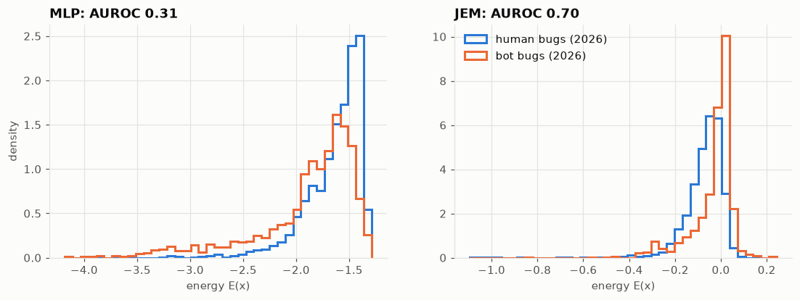
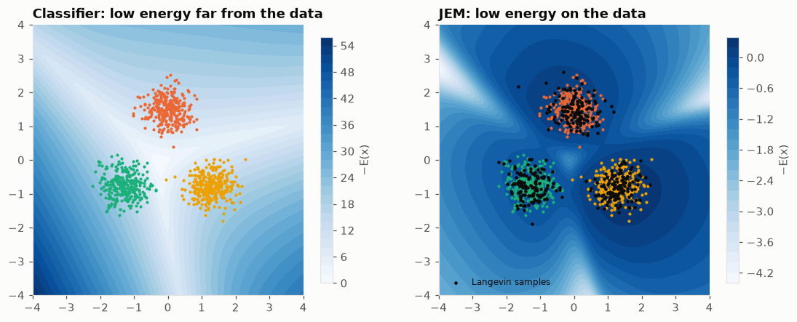

# Bug report prioritisation with a Joint Energy-based Model


*English · [Français](README.fr.md)*

Automatic priority ranking of **21,000 real Mozilla bug reports** (P1, P2, P3, Low) with a
**Joint Energy-based Model** (JEM): a single network predicts a bug's priority **and** measures how atypical it
is, to flag the reports on which automatic triage should not be applied blindly.
End-to-end pipeline: Bugzilla API collection, data cleaning, PyTorch modelling, MLflow experiment tracking and
Model Registry, command-line tool.

## Results

Evaluated on bugs filed in **2026**, never used for training or hyperparameter selection.

| | Logistic regression | MLP | **JEM** |
|---|---|---|---|
| Accuracy (4 classes; "always P3" baseline: 0.39) | 0.459 | 0.469 | 0.470 |
| Macro F1 | 0.400 | 0.401 | 0.399 |
| ECE (calibration, ↓) | 0.096 | 0.045 | 0.046 |
| Spearman of the urgency score | 0.292 | 0.302 | 0.307 |
| **Atypical-bug detection by energy (AUROC)** | — | 0.31 | **0.70** |

Over three additional seeds: identical accuracy (0.470 ± 0.002 vs 0.470 ± 0.007), detection
**0.61 ± 0.02 vs 0.31 ± 0.04**.



- **Priority depends as much on the team as on the bug.** The terms most associated with P1 relate to the release
  calendar (Nimbus experiments, onboarding, beta), not severity. No model exceeds ~47% accuracy: the ceiling
  comes from the labels.
- **The JEM does not raise that ceiling, but it adds an atypicality signal.** The standard classifier is *more*
  confident on bot bugs than on human bugs (AUROC 0.31, worse than chance). The JEM detects them (0.6-0.7) at no
  extra inference cost.
- **Its limits are well identified.** It detects stereotyped texts (`wptsync` 0.75, `intermittent-bug-filer`
  0.69) but not bots that write like humans (`bugmon`, `update-bot`).
- Reading the 20% of bugs ranked most urgent recovers 37% of true P1 bugs (20% at random).

## Data

- **Source**: [Mozilla Bugzilla](https://bugzilla.mozilla.org) REST API (Firefox, Core, DevTools, Toolkit, bugs
  filed since 2020): 273,611 bugs and 35,534 descriptions, collected with resumable cursor pagination.
- **Bots excluded**: two automated accounts produce 96% of P4 and 92% of P5 bugs with templated titles. Without
  excluding them, a model would learn to recognise the bot. 13 accounts identified by e-mail domain.
- **4 classes**: P1, P2, P3, Low (P4 + P5, as P4 is almost unused by humans), i.e. 21,209 bugs.
- **Leakage prevention**: `severity`, `status`, `resolution`, `keywords` and the number of comments, set during
  or after triage, are excluded. Only fields known at filing time are used: summary, description, product,
  component, type, OS.
- **Chronological split** (train 2020-2024, validation 2025, test 2026), as the priority distribution drifts.
- Bot bugs, never seen during training, serve as an **out-of-distribution set** to evaluate detection.

## Method

Each bug is represented as a dense 417-dimensional vector (TF-IDF of summary and description → 256-component SVD,
one-hot categories, standardisation). An MLP outputs logits `f(x)`:

- priority: `p(y|x) = softmax(f(x))`, plus an **urgency score** = expectation of the weights (1, 2/3, 1/3, 0);
- energy: `E(x) = −logsumexp f(x)`, with `p(x) ∝ exp(−E(x))`.

The JEM adds a likelihood term on `x` to the cross-entropy. Its negative phase is estimated with **Stochastic
Gradient Langevin Dynamics** (SGLD, 20 steps) from a persistent **replay buffer**:

```
L = CE(f(x), y) + α · [ E(x_data) − E(x_SGLD) + λ (E(x_data)² + E(x_SGLD)²) ]
```

`α` is selected on the validation set (detection of 2025 bot bugs under an NLL constraint); the epoch is selected
on validation NLL.



On a 2D example, a standard classifier's energy is lowest *far* from the data. The JEM's energy is low on the
data and high elsewhere, and Langevin samples (black) fall back onto the data.

**MLOps**: every training run is logged to MLflow (parameters, per-epoch curves, metrics, model serialised in
pyfunc format with `uv.lock`). The selected model is published to the Model Registry under the `champion` alias,
which the `jem-predict` command loads.

## Notebooks

| Notebook | Content |
|---|---|
| [01 — Data](notebooks/01_data_exploration.ipynb) | collection, bots, classes, data leakage, temporal drift |
| [02 — Features and baselines](notebooks/02_features_baselines.ipynb) | representation, lexical signal, logistic regression, MLP, calibration |
| [03 — JEM](notebooks/03_jem.ipynb) | a classifier's energy, method, selection of `α`, training |
| [04 — Evaluation](notebooks/04_evaluation.ipynb) | 2026 test, seed robustness, ranking, detection per bot type |
| [05 — Triage tool](notebooks/05_triage_tool.ipynb) | Model Registry, ranking the untriaged backlog, edge cases |

## Quick start

```bash
uv sync

uv run python -m jem_prioriser.collect              # Bugzilla collection (~35 min) -> data/bugzilla.sqlite
uv run jem-train --alpha 0 --run-name baseline-mlp  # baseline classifier
uv run jem-train --alpha 1 --run-name jem --register
uv run mlflow ui --backend-store-uri sqlite:///mlflow.db

uv run jem-predict                                  # rank the untriaged backlog with the @champion model
uv run jem-predict --input bugs.csv --output ranked.csv

uv run pytest
```

Once the database is collected, running the notebooks in order reproduces every result.

## Project structure

```
src/jem_prioriser/
  collect.py     Bugzilla API collection -> SQLite
  cleaning.py    bot exclusion rules, class definitions
  dataset.py     leakage-free dataset, chronological split
  features.py    TF-IDF, one-hot, SVD, standardisation
  model.py       MLP, energy, replay buffer, SGLD, JEM loss
  train.py       training and MLflow tracking (jem-train)
  metrics.py     classification, calibration, ranking, AUROC
  prioriser.py   triage tool and MLflow pyfunc model
  predict.py     command-line interface (jem-predict)
  toy.py         2D example for visualising the energy
notebooks/       analyses and results
tests/           unit tests
docs/figures/    README figures
```

## Limitations and next steps

- The model reproduces the teams' triage habits: a startup crash can be predicted P3.
- Atypicality detection is bounded by the representation: an off-topic text whose words are unknown to the
  TF-IDF vocabulary looks like a very short, ordinary bug.
- Training costs ~13× more than the classifier alone, and detection varies from one epoch to the next.
- Next steps: sentence embeddings, ordinal loss, reconstructing field values at filing time from the Bugzilla
  history, a review threshold calibrated on the team's capacity.

## Reference

W. Grathwohl, K.-C. Wang, J.-H. Jacobsen, D. Duvenaud, M. Norouzi, K. Swersky.
*Your Classifier is Secretly an Energy Based Model and You Should Treat it Like One.* ICLR 2020.

## License

Released under the [MIT License](LICENSE).
