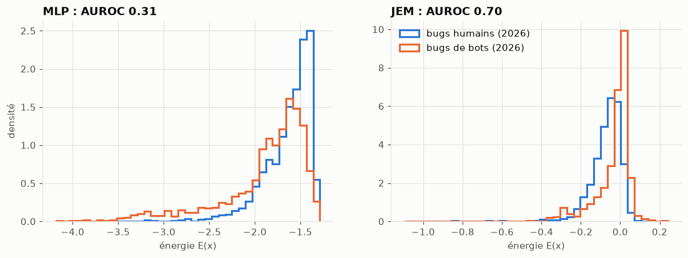
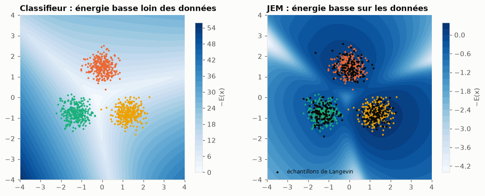

# Priorisation de rapports de bugs avec un Joint Energy-based Model


Classement automatique de **21 000 rapports de bugs réels de Mozilla** par priorité (P1, P2, P3, Basse), avec
un **Joint Energy-based Model** (JEM) : un même réseau prédit la priorité d'un bug **et** mesure à quel point il
est atypique, pour signaler les rapports sur lesquels le tri automatique ne doit pas être appliqué aveuglément.
Pipeline complet : collecte via l'API Bugzilla, nettoyage, modélisation PyTorch, suivi d'expériences et Model
Registry MLflow, outil en ligne de commande.

## Résultats

Évaluation sur les bugs créés en **2026**, jamais utilisés pour l'entraînement ni pour le choix des hyperparamètres.

| | Régression logistique | MLP | **JEM** |
|---|---|---|---|
| Accuracy (4 classes, référence « toujours P3 » : 0,39) | 0,459 | 0,469 | 0,470 |
| F1 macro | 0,400 | 0,401 | 0,399 |
| ECE (calibration, ↓) | 0,096 | 0,045 | 0,046 |
| Spearman du score d'urgence | 0,292 | 0,302 | 0,307 |
| **Détection des bugs atypiques par l'énergie (AUROC)** | — | 0,31 | **0,70** |

Sur trois graines supplémentaires : accuracy identique (0,470 ± 0,002 contre 0,470 ± 0,007), détection
**0,61 ± 0,02 contre 0,31 ± 0,04**.



- **La priorité dépend autant de l'équipe que du bug.** Les termes les plus associés aux P1 relèvent du calendrier
  des versions (expériences Nimbus, onboarding, bêta), pas de la gravité. Aucun modèle ne dépasse ~47 %
  d'accuracy : le plafond vient des étiquettes.
- **Le JEM ne change pas ce plafond, mais ajoute un signal d'atypicité.** Le classifieur standard est *plus*
  confiant sur les bugs de bots que sur les bugs humains (AUROC 0,31, pire que le hasard). Le JEM les repère
  (0,6-0,7) sans coût d'inférence supplémentaire.
- **Ses limites sont identifiées.** Il détecte les textes stéréotypés (`wptsync` 0,75, `intermittent-bug-filer`
  0,69) mais pas les bots qui rédigent comme des humains (`bugmon`, `update-bot`).
- En lisant les 20 % de bugs jugés les plus urgents, on retrouve 37 % des vrais P1 (20 % au hasard).

## Données

- **Source** : API REST de [Bugzilla Mozilla](https://bugzilla.mozilla.org) (Firefox, Core, DevTools, Toolkit,
  bugs créés depuis 2020) : 273 611 bugs, 35 534 descriptions, collecte reprenable par pagination par curseur.
- **Bots exclus** : deux comptes automatiques produisent 96 % des P4 et 92 % des P5 avec des titres gabarits.
  Sans exclusion, un modèle apprendrait à reconnaître le bot. 13 comptes identifiés par domaine e-mail.
- **4 classes** : P1, P2, P3, Basse (P4 + P5, P4 étant quasi inutilisée par les humains), soit 21 209 bugs.
- **Prévention des fuites** : `severity`, `status`, `resolution`, `keywords` et le nombre de commentaires, fixés
  pendant ou après le triage, sont exclus. Seuls les champs connus au dépôt sont utilisés : titre, description,
  produit, composant, type, OS.
- **Découpage chronologique** (train 2020-2024, validation 2025, test 2026), la répartition des priorités dérivant
  dans le temps.
- Les bugs de bots, jamais vus à l'entraînement, servent de **jeu hors distribution** pour évaluer la détection.

## Méthode

Chaque bug est représenté par un vecteur dense de 417 dimensions (TF-IDF titre et description → SVD 256,
one-hot des catégories, standardisation). Un MLP produit des logits `f(x)` :

- priorité : `p(y|x) = softmax(f(x))`, et un **score d'urgence** = espérance des poids (1, 2/3, 1/3, 0) ;
- énergie : `E(x) = −logsumexp f(x)`, avec `p(x) ∝ exp(−E(x))`.

Le JEM ajoute à l'entropie croisée un terme de vraisemblance de `x`, dont la phase négative est estimée par
**dynamique de Langevin** (SGLD, 20 pas) à partir d'un **replay buffer** persistant :

```
L = CE(f(x), y) + α · [ E(x_données) − E(x_SGLD) + λ (E(x_données)² + E(x_SGLD)²) ]
```

`α` est choisi sur la validation (détection des bots de 2025 sous contrainte de NLL), la sélection d'époque
se fait sur la NLL de validation.



Sur un exemple 2D, l'énergie d'un classifieur standard est minimale *loin* des données. Celle du JEM est basse
sur les données et haute ailleurs ; les échantillons de Langevin (en noir) retombent sur les données.

**MLOps** : chaque entraînement est journalisé dans MLflow (paramètres, courbes par époque, métriques, modèle
sérialisé au format pyfunc avec `uv.lock`). Le modèle retenu est publié dans le Model Registry sous l'alias
`champion`, chargé par la commande `jem-predict`.

## Notebooks

| Notebook | Contenu |
|---|---|
| [01 — Données](notebooks/01_donnees_exploration.ipynb) | collecte, bots, classes, fuites de données, dérive temporelle |
| [02 — Représentation et références](notebooks/02_representation_baselines.ipynb) | features, signal lexical, régression logistique, MLP, calibration |
| [03 — JEM](notebooks/03_jem.ipynb) | énergie d'un classifieur, méthode, choix de `α`, entraînement |
| [04 — Évaluation](notebooks/04_evaluation.ipynb) | test 2026, robustesse aux graines, classement, détection par type de bot |
| [05 — Outil de triage](notebooks/05_outil_de_triage.ipynb) | Model Registry, tri du backlog non trié, cas limites |

## Démarrage rapide

```bash
uv sync

uv run python -m jem_prioriser.collect              # collecte Bugzilla (~35 min) -> data/bugzilla.sqlite
uv run jem-train --alpha 0 --run-name baseline-mlp  # classifieur de référence
uv run jem-train --alpha 1 --run-name jem --register
uv run mlflow ui --backend-store-uri sqlite:///mlflow.db

uv run jem-predict                                  # trie le backlog non trié avec le modèle @champion
uv run jem-predict --input bugs.csv --output tries.csv

uv run pytest
```

Les notebooks s'exécutent dans l'ordre une fois la base collectée ; ils reproduisent l'ensemble des résultats.

## Structure

```
src/jem_prioriser/
  collect.py     collecte API Bugzilla -> SQLite
  cleaning.py    règles d'exclusion des bots, définition des classes
  dataset.py     dataset sans fuite, découpage chronologique
  features.py    TF-IDF, one-hot, SVD, standardisation
  model.py       MLP, énergie, replay buffer, SGLD, perte JEM
  train.py       entraînement et suivi MLflow (jem-train)
  metrics.py     classification, calibration, classement, AUROC
  prioriser.py   outil de triage et modèle MLflow pyfunc
  predict.py     interface en ligne de commande (jem-predict)
  toy.py         exemple 2D de visualisation de l'énergie
notebooks/       analyses et résultats
tests/           tests unitaires
docs/figures/    figures du README
```

## Limites et perspectives

- Le modèle reproduit les habitudes de triage des équipes : un crash au démarrage peut être prédit P3.
- La détection d'atypicité est bornée par la représentation : un texte hors sujet aux mots inconnus du
  vocabulaire TF-IDF ressemble à un bug très court, donc ordinaire.
- Entraînement ~13 fois plus coûteux que le classifieur seul ; détection variable d'une époque à l'autre.
- Perspectives : embeddings de phrases, perte ordinale, reconstitution de l'état des champs au dépôt via
  l'historique Bugzilla, seuil de revue calibré sur la capacité de l'équipe.

## Référence

W. Grathwohl, K.-C. Wang, J.-H. Jacobsen, D. Duvenaud, M. Norouzi, K. Swersky.
*Your Classifier is Secretly an Energy Based Model and You Should Treat it Like One.* ICLR 2020.
